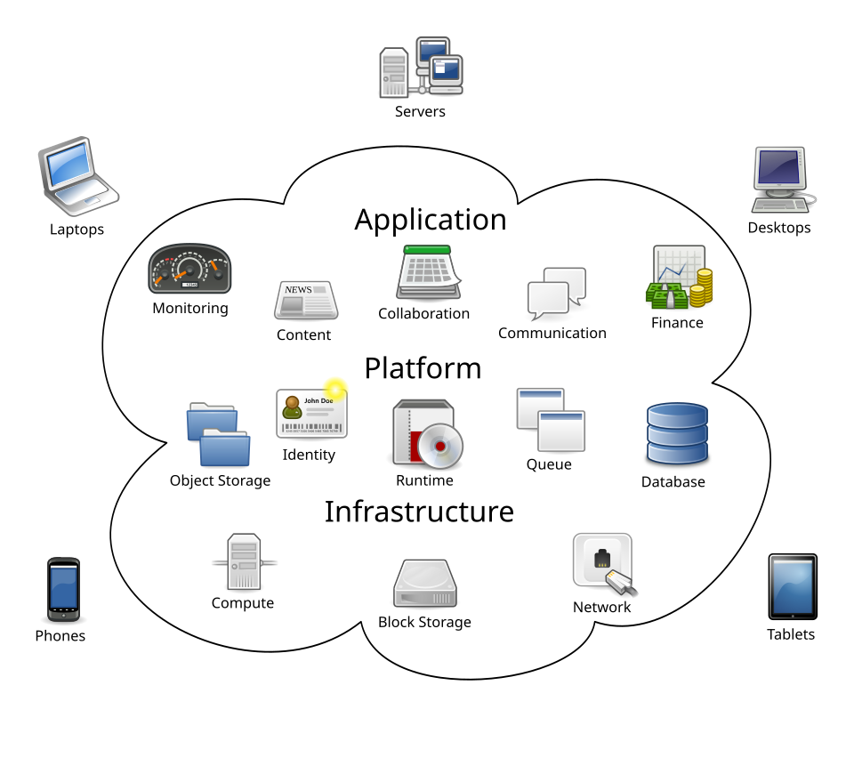
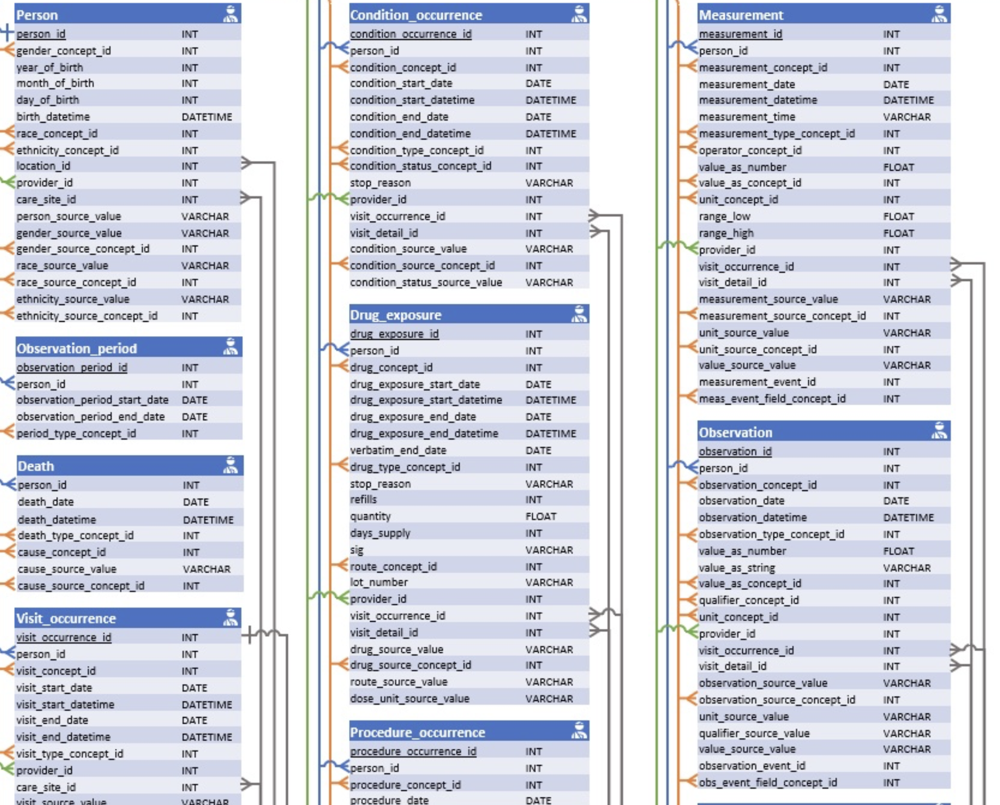

## Learning Objectives

In this session, we will start with an overview of cloud computing concepts. We will then log into the *All of Us* Workbench and build the cohort and datasets for your project.

At the end of Session 1, learners will be able to:

1. Define the concept of cloud computing and its advantages in working with large and sensitive data.
2. Identify and navigate the components of Researcher Workbench.
3. Demonstrate proper steps of starting and ending analysis sessions in the Workbench.
4. Demonstrate using the Workbench tools to create datasets

## What is Cloud Computing?

Cloud computing is the on-demand availability of computing resources (servers, storage, software, etc) over the internet. Common services include AWS by Amazon, Azure by Microsoft, and Google Cloud Platform (GCP). The *All of Us* Researcher Workbench is built on GCP. Cloud computing allows users to only pay for what they use without having to maintain the computing resources themselves.

"Cloud Computing" by Sam Johnston is licensed under 
  <a href="https://creativecommons.org/licenses/by-sa/3.0/">CC BY-SA 3.0</a>.

Cloud computing is especially advantageous for researchers to share and analyze large data as they do not have to buy and maintain expensive hardware. Cloud computing is also secure and provides better protection for sensitive data than if it were stored in individual researchers' own machines.

## OMOP Common Data Model

Raw data collected from various EHR systems lack standardization that makes analysis challenging. The *All of Us* Research Program harmonizes the data in accordance to the [OMOP CDM](https://ohdsi.github.io/CommonDataModel/index.html) framework in which clinical terms such as medication names, diagnoses, procedures, etc, are mapped to the OMOP standard vocabulary. For example, SNOMED is the standard vocabulary for conditions and RxNorm is the standard vocabulary for drugs. Then, all concepts are assigned an "OMOP Concept ID", which is globally unique across all concept domains, allowing an accurate and efficient query. Refer to this support article for more details: [Understanding OMOP Basics](https://support.researchallofus.org/hc/en-us/articles/360039585391-Understanding-OMOP-Basics)

A good way to look up a concept is [Athena database](https://athena.ohdsi.org). I often use Athena to:

- obtain the code or concept ID for a term
- inspect hierarchical relationship of a concept
- translate between different vocabularies (for example, between ICD-10 and SNOMED)

## Relational Database

*All of Us* data is organized in so-called "relational database." In a relational database, data is not stored in a single, massive spreadsheet, but rather organized into multiple, specialized tables that are linked together through shared identifiers called "keys." This structure ensures data integrity and efficiency.

(Full diagram at: <http://ohdsi.github.io/CommonDataModel/cdm54erd.html>)

Structured Query Language (SQL) is a programming language for interacting with relational databases. In *All of Us* context, point-and-click data extraction tools in the Workbench generates SQL queries automatically, which are then pasted to a notebook and run to extract data. Advanced users can write their own SQL queries themselves.

However, knowledge of SQL is not necessary to conduct research projects with *All of Us* and we will not learn it in this workshop. If you are interested in learning how to use SQL to extract data, check out this support article: [Exploring Concepts with OMOP and SQL](https://support.researchallofus.org/hc/en-us/articles/360039585491-Exploring-Concepts-with-OMOP-and-SQL)

Sometimes, you might want to look up exact data tables and associated column names in *All of Us*. Check on the [Data Dictionary](https://support.researchallofus.org/hc/en-us/articles/360033200232-Data-Dictionaries) which shows you exactly how all the data are organized. It also contains information about suppressed data types.

::: {.callout-note}
## Workbench 2.0 Changes
With the new Verily Workbench ("Workbench 2.0"), there are extra tables that facilitate faster queries. So when you query using Data Explorer, the resulting dataset may contain table names and column names that do not appear in the official OMOP CDM.
:::

## Navigating Researcher Workbench

Demonstration in class:

- Legacy Workbench vs. Verily Workbench
- Creating a Workspace
  - [Writing Your Workspace Description](https://support.researchallofus.org/hc/en-us/articles/30351591538580-Writing-Your-Workspace-Description)
- Types of Resources

## File Management

- Bucket for storage
- Deleting files: exercise caution!

## Billing

- Pods
- Initial credits
- What happens when initial credits expire
- 3 components:
  - Data extraction
  - Computation
  - Storage
- Monitoring cost

## Using Data Explorer

Demonstration in class:

- Selecting cohorts
- Adding concepts
- Saving data snapshot

## Preparing for Next Session

In Session 2, we will learn basic R programming. We will use [Google Colab](https://colab.research.google.com), a cloud-based Jupyter environment. This way, you do not have to deal with installations on your own machine and can start coding right away from a browser window.

